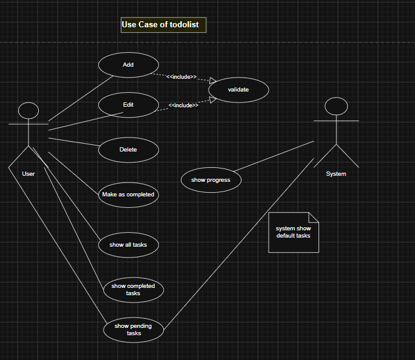

# ***ToDoList with (React + Tailwind CSS)***

## An interactive and fully-featured task management application

## **Video Demo:**
<video src="public/videos/video_readme.mp4" autoplay loop muted playsinline width="100%">
  Your browser does not support the video tag.
</video>

---

## Features

- **Full CRUD Operations:** Effortlessly add, delete, edit tasks, and toggle completion status.
- **Advanced Filtering:** View tasks by status (_All_, _Completed_, _Pending_) with full ability to edit or delete tasks under any filter without state sync issues.
- **Dynamic Progress Tracking:** Real-time progress bar automatically updating completion count and percentage .
- **Clean & Modern UI:** A soothing and eye-friendly interface built with Tailwind CSS, fully responsive.

---

## Use Cases (using https://www.drawio.com/)



---

## Tech Stack

- **React.js** - UI components and State Management
- **Tailwind CSS** - Modern, responsive styling

---

## Getting Started

1. **Clone the repository:**
   ```bash
   git clone https://github.com/Sondosprg/TodoList_tailwind_react.git
   ```
2. ```bash
   npm install
   ```

3. ```bash
    npm run dev
   ```

## Built by: []

🌟 If you like this project, don't forget to give it a star on GitHub!
